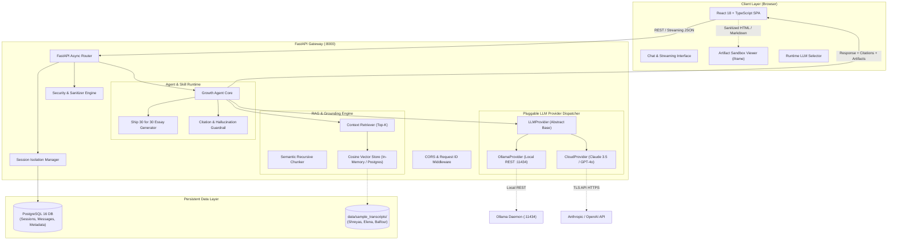
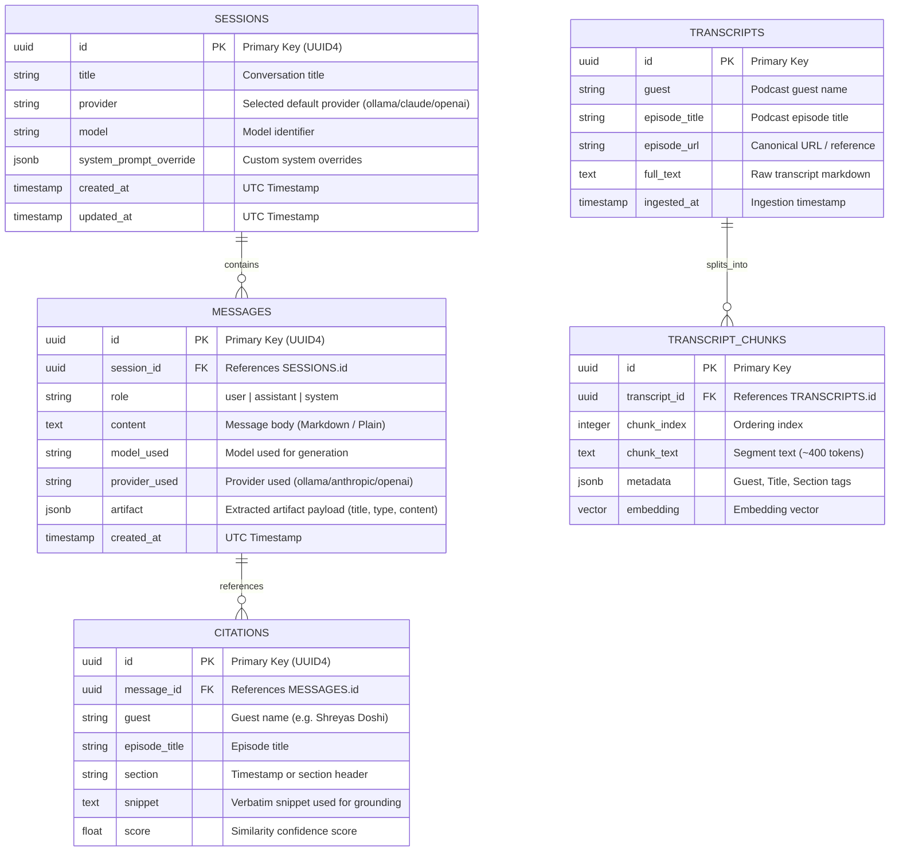

# System Architecture & Technical Specification
## The Lenny Growth Assistant

### 1. High-Level System Architecture & Topology

The Lenny Growth Assistant is built on a decoupled, cloud-agnostic forward-deployed architecture. The system orchestrates containerized services via Docker Compose: a high-concurrency FastAPI asynchronous backend, a high-performance React + TypeScript frontend, a PostgreSQL database for persistent isolated session state, and a local Ollama container for zero-dependency offline inference.

---

### 2. Database Schema (SQLAlchemy 2.0 Async)

The system enforces relational integrity and strict session-level isolation. Each session maintains independent message threads and parameters without cross-talk.

---

### 3. Data Flow & End-to-End Execution Lifecycles

#### A. Ingestion Flow (`data/ingest.py`)
1. Ingestion CLI traverses `data/sample_transcripts/` reading `.md` and `.txt` files.
2. Metadata header is parsed (Guest, Episode Title, Episode Number).
3. `RecursiveSemanticChunker` decomposes text with overlapping windows (chunk size: 800-1200 characters, overlap: 150 characters), preserving speaker turns and paragraph boundaries.
4. Chunks are converted into vector embeddings and indexed in `VectorStore` with metadata tags.

#### B. Query & Agent Execution Flow
1. **User Request**: User sends a prompt via Frontend with an optional provider switch (e.g., `ollama` or `claude-3-5-sonnet`).
2. **Context Retrieval**: `Retriever` queries `VectorStore` for top-$k$ relevant chunks ($k=4$) matching the user query semantics.
3. **Guardrail Evaluation**:
   - If maximum retrieval similarity is below the relevance threshold ($< 0.35$), the agent returns the deterministic grounded refusal:
     `"I cannot find information about this in the podcast transcripts."`
   - If relevant chunks exist, context is formatted with explicit tags: `[Guest: {guest} | Title: {episode_title} | Section: {section}]`.
4. **Agent Skill Execution**:
   - If the user requested an essay, synthesis, or framework draft (or invoked the Ship 30 mode), `ship30_writer.py` activates: enforces the ~1,250 word atomic essay format (Hook, Story/Framework, Bulleted Evidence, Single Actionable Takeaway).
   - The provider executes the prompt and streams or returns the grounded response.
5. **Artifact Detection & Sanitization**:
   - The backend and frontend detect structured code blocks (HTML, Markdown essays, SVG diagrams).
   - Artifact payloads are sanitized, packaged into structured JSON, and dispatched to the client.
6. **Persistence**: The query and generated response (including citations and artifact metadata) are committed to PostgreSQL within the isolated session ID.

---

### 4. Security & Isolation Architecture

1. **Defense-in-Depth Artifact Sandboxing**:
   - Generated HTML/CSS/JS is rendered in a dedicated child `<iframe>`.
   - The iframe is isolated with attribute `sandbox="allow-scripts"` (strictly omitting `allow-same-origin`, `allow-top-navigation`, and `allow-modals`). This guarantees that scripts cannot access the parent application's DOM, local storage, cookies, or dispatch requests under parent origins.
   - Content is pre-sanitized using strict attribute and tag allow-lists, neutralizing potential XSS vectors before rendering.

2. **Secret & Key Isolation**:
   - Cloud keys (`ANTHROPIC_API_KEY`, `OPENAI_API_KEY`) are optional and managed strictly through backend environment variables (`.env`).
   - The client application never receives or stores raw API keys.
   - If an API key is missing, the system gracefully falls back to local Ollama or returns a safe structured error rather than exposing stack traces.

3. **CORS & Input Validation**:
   - Strict CORS configuration restricts origins to configured frontend URLs.
   - All input requests are validated against strict Pydantic v2 schemas with length caps and type coercion.
   - SQL operations use SQLAlchemy async ORM with parameterized queries, preventing SQL injection.
